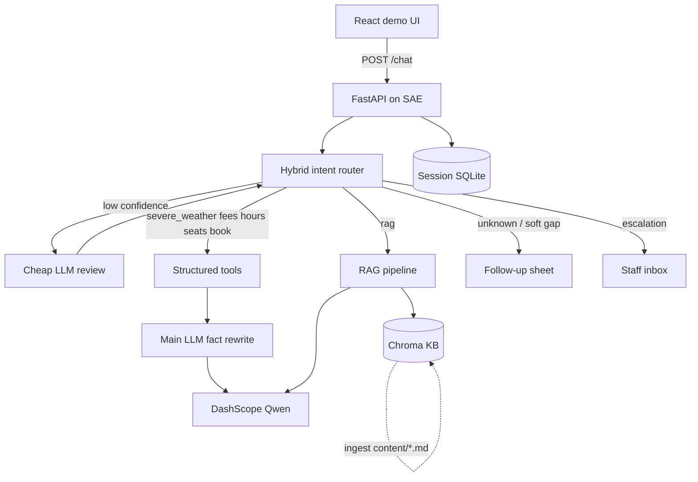

# Architecture notes

Full end-to-end behaviour, rule catalogue, and inspector contract: **[TEAM.md](TEAM.md)**.

## Turn contract

1. Load session memory  
2. Score intent rules → priority pick → optional arbiter  
3. Tool path **or** RAG path **or** staff path  
4. Persist turns · return `trace` for the inspector  

## Why tools + RAG

| Question type | Path | Why |
|---------------|------|-----|
| Typhoon / Christmas / hours | Structured / calendar | Must not be guessed |
| Phonics fee | Fee guide tool | Published numbers |
| Private 1:1 explainer | RAG | Narrative KB |
| Saturday seats | Booking tool | Live CSV register |
| Scuba | Unknown programme | Honest refuse + sheet |
| Allergy emergency | Escalation | Human + inbox |

## RAG (self-built)

chunk → embed (DashScope) → Chroma top-k → lexical rerank → Qwen generate → citations with **rank, score, full text**.
