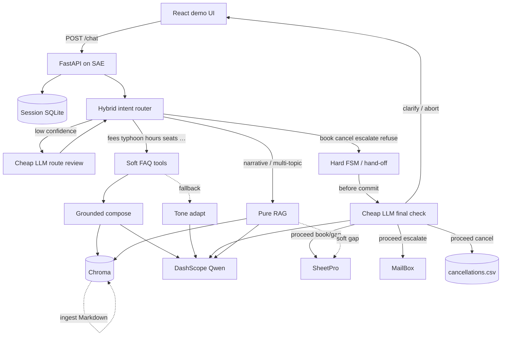

# BrightNest architecture

Canonical behaviour, rule catalogue, inspector contract, and env flags: **[TEAM.md](TEAM.md)**.  
This page is the compact systems view for slides and the live demo.

---

## Topology

```text
Browser (HTTPS)
  └─ React SPA  /COMP6708_A3_Demo   (Vercel · developer-site)
       │  same-origin /brightnest-api/*
       ▼
     FastAPI on Alibaba SAE (cn-hongkong) · Docker brightnest-api:vN
       │
       ├─ hybrid intent router (+ optional route arbiter)
       ├─ centre facts / opening hours / CSV register
       ├─ booking FSM · cancel FSM · escalation · refuse
       ├─ final check (cheap LLM commit gate)
       ├─ grounded compose / adapt / pure RAG
       ├─ SheetPro (admin_todos) · MailBox (staff_messages)
       └─ Chroma KB ← content/{en,zh-HK,zh-CN}/**/*.md
            DashScope: embeddings + Qwen (+ cheap arbiter model)
```

| Tier | Host | Notes |
|------|------|-------|
| UI | Vercel | WhatsApp-shaped chat left; System inspector + Staff desk right |
| API | SAE HK | Always-on CU billed while RUNNING — stop when idle |
| Models | DashScope | Chat, embeddings, route arbiter, final check, polish |

---

## Request flow



### Turn contract

1. Load session memory (last N turns).
2. Score detectors → conflict clears → optional prototype blend → priority pick.
3. Optional **route arbiter** (`keep` | `rag`) when confidence is low / conflicts matter.
4. Branch:
   - **Grounded compose** — privileged structured/live doc + KB enrich.
   - **Hard FSM / hand-off** — book, cancel, escalate, refuse (retrieve bypassed).
   - **Pure RAG** — retrieve → generate (+ gap polish / SheetPro).
5. On hard commits: **final check** → `proceed` | `clarify` | `abort` (safety fail-opens).
6. Persist turns · return `trace` for the inspector.

---

## Three answer tiers

| Tier | Examples | Retrieve | LLM role |
|------|----------|----------|----------|
| Hard FSM + final check | Book assessment, cancel, escalate, refuse | Bypass | Cheap commit gate; templates own the reply |
| Live tools (+ enrich) | Typhoon+HKO, hours calendar, seats | Enrich only | Compose with live doc privileged |
| Pure RAG | Fees, address, payment, teachers, programmes, policies | Full | Generate + citations |

---

## Why each path exists

| Parent ask | Path | Why |
|------------|------|-----|
| Typhoon / Christmas / hours | Live tool + enrich | Must not invent a signal or holiday |
| Phonics fee / address / FPS / teachers | Pure RAG | Static FAQ lives in KB Markdown |
| Private 1:1 / phonics lessons | Pure RAG | Narrative KB with visible chunks |
| Saturday seats | Seat browse in chat | Live CSV register; no fake Book UI |
| Book Jason / assessment Yes | Booking FSM → **final check** → SheetPro | Parent affirm + model go-ahead |
| Cancel → Yes / No | Cancel FSM → final check / abort | Decline keeps the class |
| Allergy emergency | Escalate → final check (fail-open) | Human + MailBox |
| Tokyo weather / fish biology | Refuse / off-topic gate | Stay centre-scoped |

---

## Intent scores (not retrieval sim)

Scores are mostly **fixed detector awards** (`hard_regex`, `sticky_state`, …), conflict clears, and optional prototype blends. See TEAM §3 for the ledger, priority order, and worked examples.

- High-confidence structured routes usually **skip** the route arbiter (`top ≥ 0.9`).
- Sticky book/cancel mid-flight are not yanked by the arbiter.
- `staff_escalation` is never route-arbitrated; safety commits are never blocked by final check.

---

## RAG (self-built)

```text
chunk Markdown → embed (DashScope) → Chroma ∥ BM25
  → channel pack (3 dense + 2 BM25) → Qwen generate → citations
  (rank, score, full text in the inspector)
```

Training-free: edit `content/**` → `/admin/reindex`. No fine-tune loop.

---

## Demo UI contract (short)

- **Left:** parent chat only (WhatsApp-shaped).
- **Right / System:** probes, router decision, score ledger, grounding, final check step, RAG/enrich expand, class register, session memory.
- **Right / Staff desk:** SheetPro follow-ups · MailBox urgent mail.

Talk track: [demo-script.md](demo-script.md).
