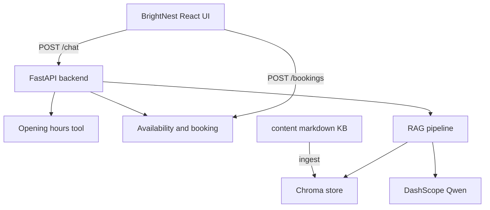

# Architecture notes

## RAG details

1. **Ingest** (`rag/ingest.py`): parse frontmatter + body, chunk ~900 chars with overlap, embed, upsert into Chroma.
2. **Retrieve** (`rag/pipeline.py`): embed query, cosine top-k, optional `language` metadata filter with unfiltered retry.
3. **Generate** (`rag/generator.py`): prompt with persona + excerpts; DashScope chat completions; extractive fallback if no key.

## Why not Bedrock KB?

Assignment emphasis is understanding the technique. Implementing chunk/embed/retrieve/generate in-repo makes the design auditable for the live demo and slides.
